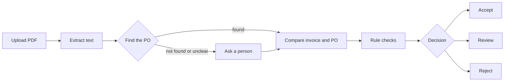

# PO Matcher

**Invoice processing, from PDF to decision.** Drop in a vendor invoice and PO Matcher reads it, finds its purchase order, checks the two against each other and decides what to do: **accept**, **send to review** or **reject**. Every step, and the reason for the decision, is visible.

Built for the AI Solutions Analyst case study, problem statement PS-1 (Finance / AP).

**Live demo: [http://13.204.36.209](http://13.204.36.209)**

---

## Try it in two minutes

1. Open the [live demo](http://13.204.36.209) and go to **Test invoices**.
2. Press **Check it** next to any invoice. You can also download one, or [all of them as a zip](http://13.204.36.209/samples/iitm-test-invoices.zip), and drop it on the page.
3. Watch each stage run live, then compare the decision with the expected result on the Test invoices page.

The 22 test invoices are billed to IIT Madras, and their purchase orders are already loaded. Half should be accepted; the other half each hide a problem the process should catch. Run the accepted set first, in order, because two of the problem cases build on earlier invoices.

---

## The problem

An AP team receives hundreds of PDF invoices a month. For each one, someone finds the matching purchase order, checks that the numbers line up and decides what to do. The work is repetitive, and mistakes are expensive.

The inputs are messy. Some invoices have a clean text layer; others are skewed scans, faxes or phone photos. PO references may be explicit, implied or missing. Vendors split one PO across several invoices, and invoices get re-sent.

PO Matcher automates the routine cases and hands a person anything it isn't sure about, together with the reason.

---

## How it works



| Stage | What happens |
|---|---|
| **1. Extract** | Each page is read on its own. Pages with a good text layer use it directly, which is exact and free. Scanned pages go to NVIDIA's Nemotron Parse vision model, with local OCR (RapidOCR) as the fallback. |
| **2. Find the PO** | An LLM suggests PO references along with the line each came from. Code confirms each one really appears in the text, then looks it up, ignoring case and punctuation. |
| **3. Ask a person** | If there's no match, several matches or an error, the run pauses and asks which PO it is. A paused run survives a server restart. |
| **4. Compare** | The LLM reports what the invoice and the PO each say, naming the PO field each value came from, so POs can use any field names. |
| **5. Rule checks** | Plain code checks the arithmetic, duplicates, vendor, currency, required fields, reading quality and the amount against the PO, including earlier invoices billed to it. |
| **6. Decide** | The strictest check wins, and the decision lists which checks passed or failed and why. |

### Decisions

| Decision | When |
|---|---|
| ✅ **Accept** | Every check passes, and billing is no more than 2% over the PO |
| 🟡 **Review** | 2–10% over the PO, missing fields, arithmetic that doesn't add up, an unclear vendor, a poor scan, or any failure along the way |
| ❌ **Reject** | A duplicate, clearly the wrong vendor, or more than 10% over the PO |

Both tolerances can be configured.

---

## Key design decisions

- **The LLM reads; code decides.** Language models are good at reading messy documents but can state a wrong total with confidence. So the LLM only extracts and compares, and every amount, sum and decision is calculated in code.
- **Failures never lead to an accept.** A timeout, an unreadable page or an ambiguous PO sends the invoice to review. The worst result of a failure is extra work for a person, not a wrong payment.
- **A person stays in the loop.** When the PO can't be identified with confidence, the process pauses and asks, instead of guessing.
- **Each page is routed separately.** One PDF can mix a digital page and a scanned page. Each page uses the cheapest method that can read it reliably.
- **Every run is recorded.** The status, timing and result of each stage are saved, so the live view and the history come from the same record.
- **Partial billing is allowed.** Vendors often split a PO across invoices, so billing under the PO is accepted, and later invoices are checked against what has already been billed.

---

## Edge cases covered

Each one is a test invoice you can run from the **Test invoices** page.

| Scenario | Expected result |
|---|---|
| Skewed scans, faxes, faint scans, sideways scans and angled phone photos | Read correctly and **accepted** |
| PO quoted only indirectly, without its usual prefix | Matched and **accepted** |
| Freight and CGST/SGST shown as separate lines | Added up correctly and **accepted** |
| First monthly bill on a six-month PO | **Accepted** as partial billing |
| A later bill that takes that PO over its limit | **Rejected** |
| A re-sent copy of an accepted invoice, as a fax (different file, same invoice) | **Rejected** as a duplicate |
| A real PO quoted by a different company | **Rejected**, wrong vendor |
| About 15% over the PO | **Rejected** |
| About 5% over the PO | **Review** |
| Line items that don't add up to the total | **Review** |
| An item that isn't on the PO, even though the total is under it | **Review** |
| No invoice number | **Review** |
| A PO that doesn't exist | **Pauses** to ask a person, then **review** |
| Billed in USD against an INR PO | **Review** |
| A password-protected PDF | **Review**, because a person has to open it |

The full list, with the PO for each invoice, is in [`backend/tests/fixtures/iitm/README.md`](backend/tests/fixtures/iitm/README.md).

---

## Tech stack

| Layer | Technology |
|---|---|
| Frontend | React 19, TypeScript, Vite |
| Backend | Python 3.13, FastAPI |
| PDF and OCR | PyMuPDF, RapidOCR (ONNX Runtime) |
| AI models | NVIDIA Nemotron Parse (scanned pages), a Nemotron LLM (PO detection and comparison) |
| Database | MongoDB Atlas, with uploaded PDFs stored in GridFS |
| Hosting | AWS EC2 (Mumbai), Docker Compose, nginx |

---

## Run it locally

You'll need [uv](https://docs.astral.sh/uv/), Node.js 22+, a MongoDB connection string and, optionally, an [NVIDIA API key](https://build.nvidia.com/).

**1. Configure**

```bash
cp backend/.env.example backend/.env
# Set MONGO_DB_URL, MONGO_DB_NAME and NVIDIA_KEY
```

Without `NVIDIA_KEY`, scanned pages are read by local OCR, but PO detection and comparison need the LLM.

**2. Start the backend** on port 8000:

```bash
cd backend
uv sync
uv run uvicorn main:app --reload --port 8000
```

**3. Start the frontend** on port 5173:

```bash
cd frontend/zamp
npm install
npm run dev
```

Open [http://localhost:5173](http://localhost:5173). The dev server forwards `/api` to the backend and serves the test invoices.

**4. Load the test purchase orders** (needed once per database):

```bash
cd backend
uv run python scripts/prepare_iitm_samples.py
```

### With Docker

```bash
docker compose up --build
```

The whole app is then at [http://localhost](http://localhost).

---

## Deployment

The live demo runs on one AWS EC2 `t3.small` in Mumbai, next to the MongoDB Atlas cluster, using Docker Compose:

- **`web`**: nginx serves the React build and the test invoices, and forwards `/api` to the backend. It is the only container open to the internet.
- **`backend`**: the FastAPI service, reachable only through nginx.

```bash
# One-time setup on a fresh Ubuntu or Amazon Linux 2023 instance
bash deploy/setup-server.sh

# Copy backend/.env to the server, then deploy, and redeploy after each push
bash deploy/deploy.sh
```

---

## Project structure

```
├── backend/                FastAPI service
│   ├── app/
│   │   ├── extraction/     Page routing, text layer, OCR and Parse readers
│   │   ├── workflow/       PO detection, comparison, rule checks, decision policy
│   │   ├── services/       Run orchestration, documents, purchase orders
│   │   ├── infrastructure/ MongoDB, GridFS, PyMuPDF, RapidOCR, NVIDIA adapters
│   │   ├── domain/         Models, errors and interfaces
│   │   └── api/            HTTP routes and schemas
│   ├── scripts/            Test data and evaluation scripts
│   └── tests/              Unit, API, integration and evaluation tests
├── frontend/zamp/          React app: live run view, history, purchase orders, test invoices
├── deploy/                 Server setup and deploy scripts
└── docker-compose.yml
```

[`backend/README.md`](backend/README.md) covers the API endpoints, the extraction rules, every rule check and the error handling in more detail.

---

## Testing

```bash
cd backend
uv run pytest                          # Unit and API tests, no network or database
uv run pytest tests/integration        # Real PDF reading, OCR and the NVIDIA API
uv run python scripts/run_eval.py      # The full process on labelled invoices
```

The evaluation script runs the whole process against labelled invoices with the real LLM. The number that matters most is wrong accepts, which must stay at zero.

---

## Limitations and next steps

- **Security:** the demo has no login and is served over plain HTTP. A production version would add authentication, HTTPS on a domain and per-company data separation.
- **Data privacy:** scanned pages are sent to NVIDIA's hosted API under its trial terms. Real invoices would call for a self-hosted model or an enterprise agreement, or `NVIDIA_KEY` left unset so only local OCR is used.
- **Volume:** invoices are processed one at a time, because OCR is CPU-heavy. Higher volume would need a job queue with separate workers.
- **Integrations:** invoices are uploaded by hand. The next step would be to pull them from an AP mailbox and send decisions to the accounting system.
